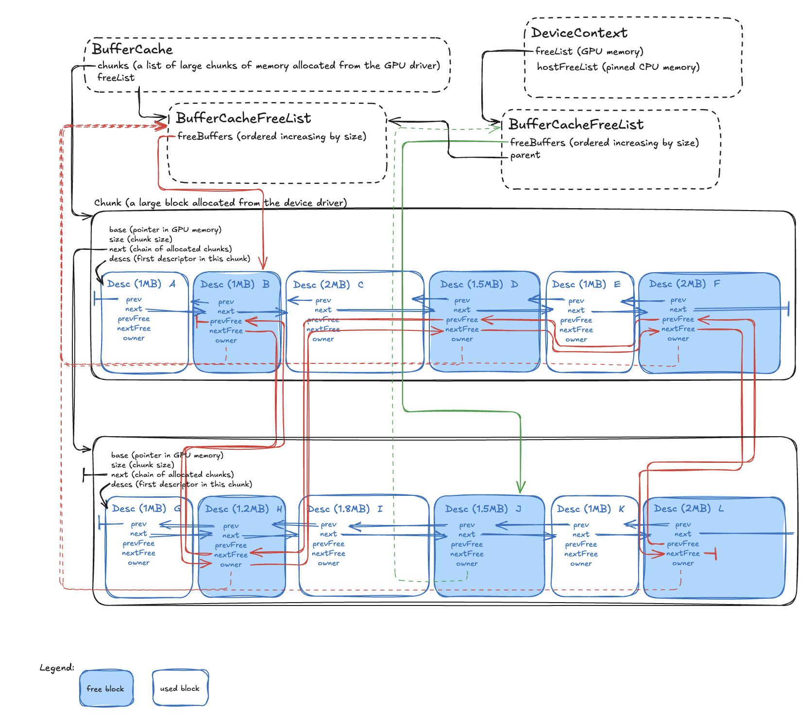

# Buffer Cache Overview

The buffer cache is a memory manager for host or device allocated memory. It
grabs chunks of memory from underlying allocators (e.g. CUDA/HIP drivers) and
hands them out to clients as necessary. Host allocated memory here means memory
allocated on the host via the CUDA or HIP drivers. This is often called pinned
memory. Device allocated memory means GPU memory on the device.

## Problem Statement and Motivation

GPU memory allocation through CUDA/HIP APIs (cudaMalloc/hipMalloc) is expensive:

- **System call overhead**: 100-1000μs per allocation vs ~1μs for cache hits
- **GPU memory fragmentation**: Available memory becomes unusable over time
- **Allocation failures**: When memory appears available but is fragmented
- **Synchronization overhead**: Between host and device operations
- **Stream ordering**: Need to respect CUDA/HIP stream dependencies

The BufferCache solves these problems by:

- **Pre-allocating large chunks**: Reduces expensive CUDA/HIP syscalls
- **Implementing coalescing**: Automatically merges adjacent free blocks to
  reduce fragmentation
- **Hierarchical free lists**: Stream-local caching with fallback to shared
  pools
- **Unified interface**: Supports both host and device memory through the same
  API
- **Stream-aware operations**: Respects asynchronous GPU execution models

## Underlying Memory API Mapping

### CUDA Integration

- **Chunk Allocation**: `cudaMalloc()` for device memory, `cudaMallocHost()` for
  pinned host memory
- **Chunk Deallocation**: `cudaFree()` / `cudaFreeHost()`
- **Memory Info**: `cudaMemGetInfo()` to query available GPU memory for sizing
  decisions
- **Stream Association**: Operations respect CUDA stream ordering for async
  allocations

### HIP Integration

- **Chunk Allocation**: `hipMalloc()` for device memory, `hipHostMalloc()` for
  host memory
- **Chunk Deallocation**: `hipFree()` / `hipHostFree()`
- **Memory Info**: `hipMemGetInfo()` to query available GPU memory
- **Stream Association**: Operations respect HIP stream ordering

### Allocation Modes

- **`SYNC`**: Synchronous allocation (safe for immediate use, may block)
- **`ASYNC`**: Asynchronous allocation (stream-ordered, higher performance)
- **`HOST`**: Host/pinned memory allocation (CPU accessible, GPU transferable)

## Architecture Overview



The source of the above image is available
[here](https://excalidraw.com/#json=fvkxYZNkbOnKZGoYDFvvs,7FnGbaodiDehk0RVWHDlRQ).

### Memory Layout

The buffer cache operates on a two-level hierarchy:

1. **BufferCache**: Owns large memory chunks allocated from CUDA/HIP
2. **BufferCacheFreeList**: Manages free blocks within chunks, with hierarchy:
   - **Parent/Shared**: Global free list accessible to all DeviceContexts
   - **DeviceContext-local**: Stream-specific free lists for better cache
     locality

### Example Setup

In the diagram above, we have allocated two chunks of memory with a set of
memory blocks each. A chunk starts with a single large memory block which is
subdivided into multiple blocks as needed to satisfy allocation requests.

There are 5 blocks on the shared BufferCache free list (aka parent) and 1 block
on the BufferCache free list associated with the stream in the single (in this
example!) DeviceContext.

### Key Components

- **Chunk**: Large memory region allocated from CUDA/HIP (e.g., 256MB)
- **Desc (Descriptor)**: Metadata for each memory block (32-64 bytes overhead)
- **Free Lists**: Multiple sorted lists of available blocks by size
- **DescMap**: Hash table for fast lookup of descriptors by pointer (for free
  operations)

## Usage Scenarios

The following scenarios demonstrate how the buffer cache handles different
allocation and deallocation patterns:

### Scenario 1

The DeviceContext releases the memory block `K`. Since all allocations and frees
are streaming we cannot put this block into the shared/parent free list, but
instead it has to be sequestered with blocks used by the DeviceContext’s stream:

- Check whether the next and previous blocks in the chunk (`K→next` and
  `K→prev`) are free and if they have the same owner.
- Block `J` satisfies this requirement, so we merge blocks `J` and `K` and add
  the resulting block to the free list associated with the DeviceContext.

### Scenario 2

We want to allocate a new 3MB block on the DeviceContext’s stream:

- Check if the free list associated with the DeviceContext contains a block
  greater or equal to 3MB.
- Since we cannot satisfy this, we check whether the parent/shared free list
  satisfies this requirement.
- None of the existing free lists can satisfy the request to allocate 3MB, so we
  end up allocating a new chunk and split the first 3MB off into its own block,
  adding the remainder to the shared free list.

Note: We can only allocate a new chunk if we have not exhausted the maximum
configured size of the buffer cache.

### Scenario 3

The block E is freed on a different DeviceContext (not pictured) and added to
the associated free list. At some point in time later, this DeviceContext is
released:

- All free blocks on this DeviceContext’s free list are flushed to the parent
  free list, which will merge blocks D, E and F into a single 4.5MB block.

### Scenario 4

We want to allocate a 1.5MB block on the pictured DeviceContext:

- Block J is removed from the DeviceContext’s free list.
- The DeviceContext’s free list is now empty.

### Scenario 5

We want to allocate a 1.8MB block on the pictured DeviceContext:

- The DeviceContext’s free list cannot satisfy this request.
- Find a large enough block on the parent free list identifies block F as
  sufficiently large.
- Remove F from the free list.
- Split the block F into a block F1 (1.8MB) and F2 (0.2MB).
- Add F2 to the shared free list.

## Configuration

### Environment Variables

#### Device Memory Configuration

- **`MODULAR_DEVICE_CONTEXT_BUFFER_CACHE_SIZE`**: Maximum cache size in KB
  (default: uses percentage)
- **`MODULAR_DEVICE_CONTEXT_BUFFER_CACHE_SIZE_PERCENT`**: Percentage of GPU
  memory to use, after the driver has taken its memory (default: 90%)
- **`MODULAR_DEVICE_CONTEXT_BUFFER_CACHE_CHUNK_PERCENT`**: Chunk size as
  percentage of max cache size (default: 2%)

#### Host Memory Configuration

- **`MODULAR_DEVICE_CONTEXT_HOST_BUFFER_CACHE_SIZE`**: Host cache size in KB
- **`MODULAR_DEVICE_CONTEXT_HOST_BUFFER_CACHE_CHUNK_PERCENT`**: Host chunk
  percentage

#### Debugging and Testing

- **`MODULAR_DEVICE_CONTEXT_BUFFER_CACHE_LOG`**: Enable verbose logging
  (default: false)
- **`MODULAR_DEVICE_CONTEXT_BUFFER_CACHE_SELF_CHECK`**: Enable internal
  consistency checks (default: false)
- **`MODULAR_DEVICE_CONTEXT_BUFFER_CACHE_ONLY`**: Fail if cache cannot satisfy
  allocation (testing mode)

### Configuration Examples

```bash
# Use 75% of GPU memory with 10% chunk size
export MODULAR_DEVICE_CONTEXT_BUFFER_CACHE_SIZE_PERCENT=75
export MODULAR_DEVICE_CONTEXT_BUFFER_CACHE_CHUNK_PERCENT=10

# Fixed cache size of 1GB
export MODULAR_DEVICE_CONTEXT_BUFFER_CACHE_SIZE=1048576  # KB

# Enable debugging
export MODULAR_DEVICE_CONTEXT_BUFFER_CACHE_LOG=true
export MODULAR_DEVICE_CONTEXT_BUFFER_CACHE_SELF_CHECK=true
```

## Thread Safety and Performance

### Thread Safety

- All operations are protected by internal mutexes (`bufferCache_.mu_`)
- Multiple threads can safely allocate/free concurrently
- Hierarchical free lists provide some thread-local optimization
- Descriptor management is thread-safe with atomic operations where needed

### Performance Characteristics

- **Cache Hit**: ~1μs (pointer arithmetic + list manipulation)
- **Cache Miss (new chunk)**: ~100-1000μs (CUDA/HIP allocation syscall)
- **Fragmentation**: Automatic coalescing reduces fragmentation over time
- **Memory Overhead**: ~32-64 bytes per allocation (descriptor storage)
- **Alignment**: Configurable alignment (minimum 64 bytes) with minimal overhead

### Performance Best Practices

1. **Consistent allocation sizes**: Reduces fragmentation and improves cache hit
   rates
2. **Stream-local DeviceContext**: Use per-stream free lists for better locality
3. **Appropriate chunk sizing**: Balance between memory usage and allocation
   frequency
4. **Monitor cache metrics**: Track hit rates and fragmentation in production
5. **Batch operations**: Group small allocations when possible

## Code Usage Examples

### Basic Allocation Pattern

```cpp
// Get free list from device context
BufferCacheFreeList* freeList = deviceContext->freeList();

// Allocate buffer
ErrorOr<void*> ptrResult = freeList->allocate(1024, Device::AllocMode::SYNC);
if (ptrResult.isError()) {
    // Handle allocation failure - may fallback to direct device allocation
    handleError(ptrResult.takeError());
}

void* ptr = ptrResult.takeValue();
// Use the buffer...
useBuffer(ptr);

// Free when done (critical for cache efficiency)
ErrorOrSuccess freeResult = freeList->free(ptr);
if (freeResult.isError()) {
    handleError(freeResult.takeError());
}
```

### Stream-Ordered Allocation (Recommended)

```cpp
// Allocate asynchronously on stream - more efficient
ErrorOr<DeviceBufferRef> buffer = deviceContext->enqueueCreateBuffer(1024);
if (buffer.isError()) {
    handleError(buffer.takeError());
}

// Buffer is ready after stream synchronization
deviceContext->synchronize();
// Buffer automatically freed when DeviceBufferRef goes out of scope
```

### Host Buffer Allocation

```cpp
// Create host-accessible buffer for CPU/GPU transfers
ErrorOr<DeviceBufferRef> hostBuffer = deviceContext->createHostBuffer(1024);
if (!hostBuffer.isError()) {
    void* hostPtr = hostBuffer.takeValue()->ptr();
    // Can directly read/write from CPU
    memcpy(hostPtr, sourceData, 1024);
    // Can also be used in GPU operations
}
```

## Debugging and Troubleshooting

### Common Issues

1. **Out of Memory Errors**
   - Check `buffer_cache_size_percent` setting
   - Monitor GPU memory usage with `nvidia-smi` / `rocm-smi`
   - Verify application isn't leaking buffers (missing `free()` calls)

2. **Memory Fragmentation**
   - Enable logging to analyze allocation patterns
   - Reduce allocation size variance
   - Consider larger chunk sizes for workloads with many small allocations

3. **Poor Performance**
   - Profile cache hit rates with logging enabled
   - Adjust chunk percentage based on allocation patterns
   - Check for excessive allocation/free churn

### Debugging Tools

```bash
# Enable verbose logging
export MODULAR_DEVICE_CONTEXT_BUFFER_CACHE_LOG=true

# Enable self-checks (debug builds only)
export MODULAR_DEVICE_CONTEXT_BUFFER_CACHE_SELF_CHECK=true

# Force cache-only mode (testing fragmentation)
export MODULAR_DEVICE_CONTEXT_BUFFER_CACHE_ONLY=true
```

### Log Output Format

When logging is enabled, you'll see output like:

```bash
##(CUDA[0]:0x12345)##: buffer_cache(chunk_size: 268435456 ; max_cache_size: 1073741824 ; free_list: 0x67890)
##(CUDA[0]:0x12345)##: allocate_chunk(0x7f8b4c000000 ; 268435456)
##(CUDA[0]:0x12345)##: allocate on 0x67890 from free buffer at id: 0 (0x7f8b4c001000 ; 1024), 3, -1024
##(CUDA[0]:0x12345)##: free on 0x67890 (0x7f8b4c001000 ; 1024), 0, 1024
##(CUDA[0]:0x12345)##: mergeFreeBlockDesc(0x7f8b4c001000 ; 1024) - (merge next)
```

Key log entries:

- **buffer_cache**: Initial configuration
- **allocate_chunk**: New chunk allocated from CUDA/HIP
- **allocate on**: Cache hit (fast path)
- **free on**: Block returned to cache
- **mergeFreeBlockDesc**: Automatic defragmentation

### Memory Leak Detection

The buffer cache includes built-in leak detection:

- Descriptors track allocation state
- Self-check mode validates free list consistency
- Destructor asserts all memory is properly freed

### Performance Profiling

Monitor these metrics in production:

- **Cache hit rate**: Should be >90% for well-tuned applications
- **Average allocation size**: Should align with chunk sizing
- **Fragmentation ratio**: Available memory vs largest free block
- **Chunk utilization**: Percentage of allocated chunks actively used
